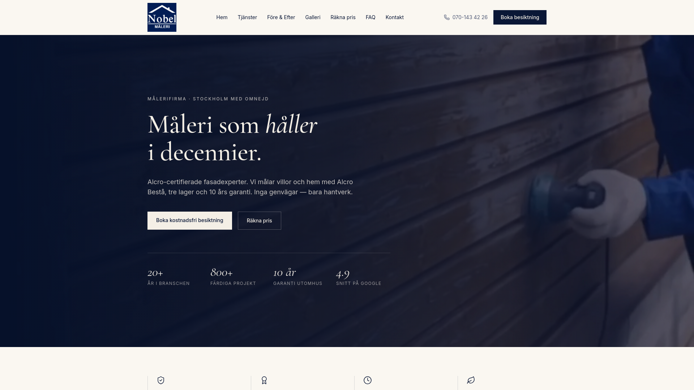

# Nobel Måleri — Website

A multi-page, Swedish-language marketing website for Nobel Måleri, a painting company serving Stockholm and the surrounding area.

**Live:** https://nobelmaleri.se



## About the project

Nobel Måleri is a painting company in Sweden that does exterior/facade painting, interior painting, window putty work, lacquering and filling. The site presents the company's services, shows its work through before/after comparisons and a photo/video gallery, and turns visitors into leads through inspection-booking and price-estimate forms.

Anas Alnaasan (via MIZA Group) handled the **design, UI/UX and development**. This included the brand application (colours, typography and logo usage), the page structure, the video-driven hero and gallery, and the service subpages.

## Features

- **Multi-page site with file-based routing.** Pages: Home (`/`), Services (`/tjanster`), service detail pages (`/tjanster/$slug`), Before & After (`/fore-och-efter`), Gallery (`/galleri`), Price calculator (`/rakna-pris`), About (`/om-oss`), FAQ (`/faq`) and Contact (`/kontakt`).
- **Video hero.** The home page hero uses an autoplaying, muted, looping brand video with a poster image and a gradient overlay, plus key figures shown as stats.
- **Autoplay video gallery.** The gallery page shows a grid of autoplaying, looping project videos followed by a lazy-loaded image portfolio.
- **Service subpages with lists.** Service content is data-driven (`src/lib/services-data.ts`). Each service has an intro, a list of what's included, a four-step process, a sidebar of all services and cross-links to the other services. Per-page SEO meta is generated from the same data.
- **Interactive before/after slider.** A draggable comparison component (`BeforeAfter.tsx`) built with pointer events and pointer capture, so it works with both mouse and touch.
- **Price calculator.** Visitors pick a service type and drag an area slider (m²) to get a rough price, the 30% ROT tax deduction, and the net amount to pay. Numbers are formatted with `Intl.NumberFormat("sv-SE")`. A booking form sits next to the calculator and is pre-filled from the visitor's choices.
- **Review slider.** A scroll-snap carousel of customer reviews with dot navigation and previous/next buttons.
- **FAQ accordion.** FAQs are grouped by topic and each item expands or collapses.
- **Contact and inspection-request forms.** The forms validate on the client and show a confirmation state after sending.
- **Brand system.** Brand colour tokens (navy, cream and paper) are defined in Tailwind v4 `@theme`. The type pairing is Cormorant Garamond (serif) and Inter (sans). The CSS also has custom utilities such as `eyebrow`, `em-serif` and `container-tight`.
- **SEO.** Each route sets its own `<title>`, description, Open Graph and Twitter meta. A dynamic `/sitemap.xml` server route lists the static pages and every service page. `robots.txt` is included.
- **Partner sections.** One section covers Alcro certification and another covers Klarna instalment payments.
- **Error handling.** The app has custom 404 and error boundaries, plus an SSR error wrapper (`src/server.ts`) that returns a branded fallback page instead of raw 500 responses.
- **Cloud backend ready.** The Supabase client, auth middleware and server-side admin client are wired up through environment variables.

## Tech stack

- **Framework:** React 19, TanStack Start (SSR) and TanStack Router (file-based routing)
- **Build:** Vite 8, configured with `@lovable.dev/vite-tanstack-config` and Nitro for the server build
- **Language:** TypeScript
- **Styling:** Tailwind CSS v4, `tw-animate-css`, shadcn/ui (Radix UI primitives) and lucide-react icons
- **Fonts:** `@fontsource/cormorant-garamond`, `@fontsource/inter`
- **Data and state:** TanStack Query
- **Backend:** Supabase (`@supabase/supabase-js`) through Lovable Cloud
- **Forms and validation available:** react-hook-form, zod
- **Tooling:** ESLint and Prettier

## Project structure

```
.
├── public/                  # favicon, robots.txt
├── src/
│   ├── assets/media/        # media index (CDN asset references)
│   ├── components/
│   │   ├── site/            # Header, Footer, PageHero, BeforeAfter, CTA, Alcro & Klarna sections
│   │   └── ui/              # shadcn/ui components
│   ├── hooks/
│   ├── integrations/supabase/  # client, server client, auth middleware, types
│   ├── lib/                 # services data, portfolio data, error handling, utils
│   ├── routes/              # file-based routes (pages + sitemap.xml)
│   ├── router.tsx
│   ├── server.ts            # SSR entry with error wrapper
│   ├── start.ts             # TanStack Start middleware setup
│   └── styles.css           # Tailwind theme + brand tokens
├── supabase/config.toml
├── vite.config.ts
└── package.json
```

## Getting started

```bash
npm install
cp .env.example .env   # then fill in your own Supabase values
npm run dev
```

Other scripts include `npm run build`, `npm run preview`, `npm run lint` and `npm run format`.

### Assets note

The images and videos (logo, hero video, gallery photos and videos, before/after pairs, service images, partner logos) are hosted on Lovable's asset CDN. They are referenced through `*.asset.json` descriptor files in `src/assets/media/`, and **those descriptor files are not included in this repository**. `src/assets/media/index.ts` still imports them, so a local build needs these files: either add your own `*.asset.json` files (each exporting a `url`) or replace the imports with local image and video paths. The missing descriptors are:

- Brand and partners: `nobel-logo.png`, `hero-logo.mp4`, `intro.mp4`, `om-nobel.mp4`, `hero-villa.jpg`, `alcro-badge.png`, `alcro-cans.webp`, `klarna-logo.png`
- Services and about: `svc-exterior.jpeg`, `svc-interior.jpeg`, `svc-window.jpeg`, `about-team.jpeg`, `about-detail.jpeg`
- Before/after: `ba1`–`ba4` (`-before` / `-after`)
- Portfolio: `p1`–`p12`, `g13`–`g25`
- Gallery videos: `v1`–`v8`

## Built with AI-assisted development

Anas Alnaasan built this project with Lovable and Claude as AI coding assistants. Anas owned the design direction, prompting, code review, iteration and deployment, and used the AI tools to speed up implementation.

## Author

**Anas Alnaasan** · MIZA Group · https://mizagroup.se · https://github.com/anasnassan92-cmyk

---

Source shared for portfolio purposes. © Nobel Måleri. All brand assets belong to their owner.
